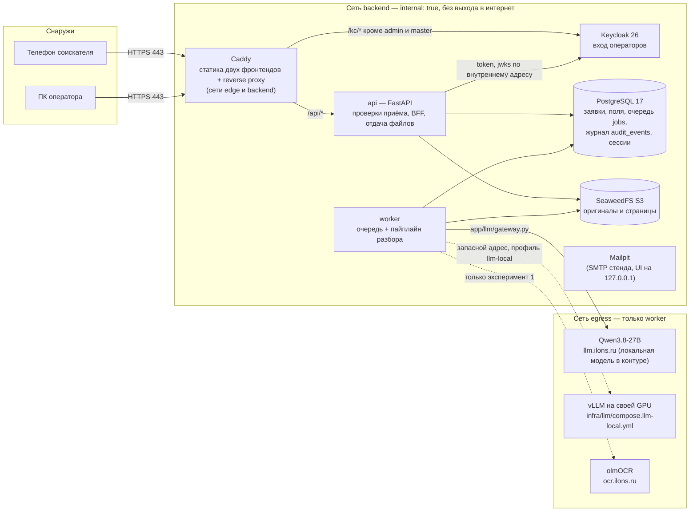

# Схема решения

## Пояснения

**Части системы.** Браузер видит только Caddy — единственный сервис с опубликованными портами (80/443; отладочные 8081 для админки Keycloak и 8025 для Mailpit — только на `127.0.0.1` хоста). Caddy отдаёт статику двух React-приложений (`/` — соискатель, `/operator/` — оператор), проксирует `/api/*` в api и `/kc/*` в Keycloak, а пути `/kc/admin*` и `/kc/realms/master*` снаружи отвечают 404. api, worker, PostgreSQL, SeaweedFS, Keycloak и Mailpit живут в сети `backend` с `internal: true`: физического выхода в интернет у них нет (проверено: из контейнера api внешнее имя не резолвится). Выход наружу — только у worker, через сеть `egress`, к адресу модели.

**Где хранятся данные.** Всё постоянное — в PostgreSQL (заявки, документы, файлы-метаданные, извлечённые поля, замечания, очередь `jobs`, журнал аудита `audit_events`, сессии операторов) и в S3 (SeaweedFS: оригиналы файлов и страницы, ключ объекта — UUID, имени файла в ключе нет). Оба на docker volume (`pg_data`, `s3_data`) и переживают перезапуск. В памяти процессов бизнес-состояния нет. Приложение работает под ролью БД `hr_app`; на `audit_events` у неё только `SELECT` и `INSERT` — журнал нельзя изменить из приложения.

**Как идёт разбор.**
1. *Приём (api, синхронно).* Сервер проверяет токен заявки, вид документа для страны, лимиты, размер, тип по сигнатуре (а не по расширению), SHA-256 на дубликат. Затем **в одной транзакции**: объект в S3 → строка `files` → задача `jobs` → запись в журнал. Если транзакция упала, объект из S3 удаляется. Ответ соискателю мгновенный.
2. *Воркер.* Несколько задач параллельно; захват задачи — `SELECT … FOR UPDATE SKIP LOCKED` с арендой (`locked_until`) и heartbeat. Reaper возвращает в очередь задачи, у которых истекла аренда (воркер убит), — работа не теряется. Ошибка модели → повтор с увеличивающейся паузой до `JOB_MAX_ATTEMPTS`, затем честный статус `failed` с причиной.
3. *Пайплайн.* Нормализация изображения (EXIF-поворот, PDF → страница PNG и текстовый слой) → проверка «слишком тёмное фото» (тогда модель не вызывается, документ «не прочитался» с советом) → **один вызов Qwen3.8** с JSON-схемой, построенной из реестра → нормализация значений по типу поля → правила реестра (форматы, контрольные суммы ИНН/СНИЛС, даты, сроки) → цвет поля → итоговый статус документа (`ready` / `needs_review` / `unreadable` / `failed`). Истёкший срок — замечание, документ не отклоняется.
4. *Цвет поля.* Зелёный — значение прочитано, напечатано (не от руки и не в штампе), правила пройдены и есть независимое подтверждение: контрольная сумма ИНН/СНИЛС или совпадение с текстовым слоем PDF. Жёлтый — прочитано, но подтвердить нечем. Красный — обязательное поле не прочитано или нарушено правило. Серый — необязательного поля нет на документе. Документ из нескольких файлов: по каждому полю берётся значение с лучшим цветом.
5. Статусы видны соискателю опросом `GET /api/public/applications/{id}` (без значений полей), оператору — в карточке и разделе «В работе».

**Где вызывается модель.** Только `backend/app/llm/gateway.py` (провайдеры `openai_compat` и `olmocr_http`). Адрес, модель и ключ — из `.env` (`LLM_BASE_URL`, `LLM_MODEL`, `LLM_API_KEY`); смена адреса не требует правки кода. Thinking выключен, temperature 0. Ответ, не прошедший схему, обрезанный (`finish_reason=length`) или ошибка сети — это ошибка, а не данные: никаких выдуманных значений. Исходное имя файла в модель не передаётся — только байты изображения.

**Вход.** Keycloak + BFF: api — конфиденциальный OIDC-клиент (Authorization Code + PKCE), токены в браузер не попадают; у браузера только HttpOnly-cookie серверной сессии. Роли (`doc-reader`, `doc-editor`, `supervisor`) — клиентские роли Keycloak, офисы — группы. Любой `/api/operator/*` и любой файл без сессии → 401; правка поля без роли редактора → 403. Операторы видят только заявки своего офиса (группы), заявка чужого офиса → 404; `supervisor` видит все.

**Периметр.** Наружу — только 443 (и 80 для редиректа). Модель и OCR — в локальном контуре, внешних облачных сервисов для персональных данных нет; фронтенды собираются без внешних CDN и шрифтов.
