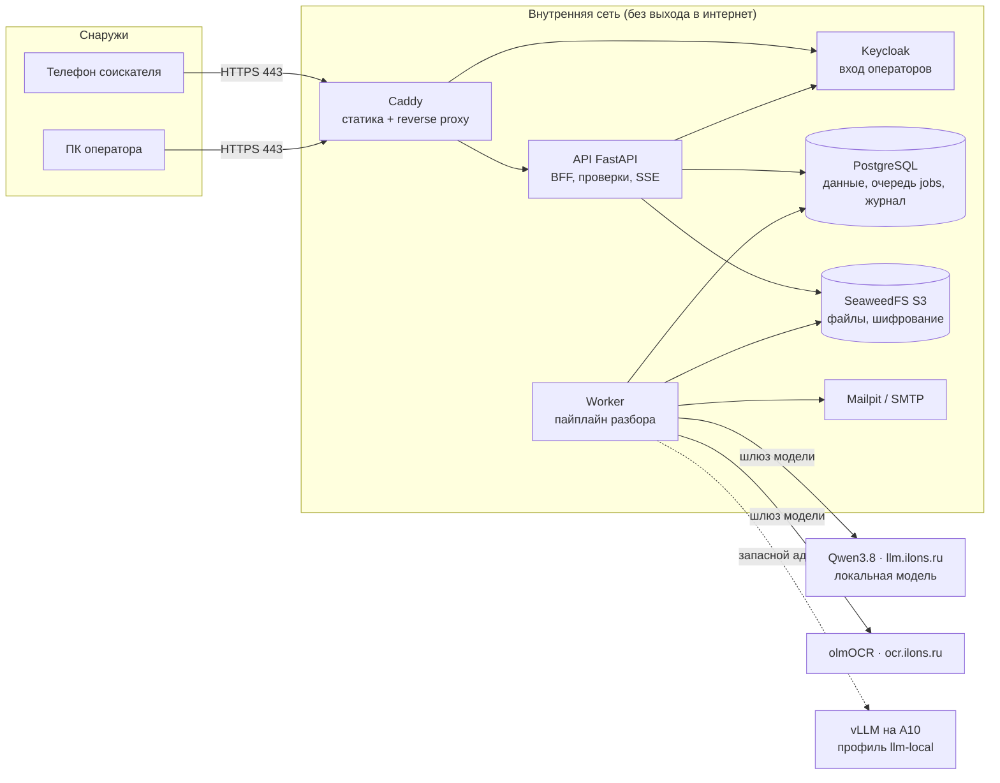

# Схема решения

<!-- Шаблон (п. 5.5.2): одна схема и страница пояснений. Схема — Mermaid (GitHub рендерит) или картинка. -->

## Пояснения

<!-- Одна страница, по абзацу:
1. Части системы и кто с кем говорит (браузер видит только Caddy; файлы отдаёт только API после проверки).
2. Где хранятся данные: PostgreSQL (заявки, поля, очередь, журнал), S3 (оригиналы и страницы, зашифрованы), ничего в памяти.
3. Как идёт разбор: приём → транзакция «файл + задача» → воркер → проходы A/B/C → сверка → цвет поля → SSE.
4. Где вызывается модель: только app/llm/gateway.py в воркере; адрес и модель из .env.
5. Вход: Keycloak + BFF, cookie, роли и офисы; 401/404.
6. Периметр: единственный открытый порт — 443.
-->
